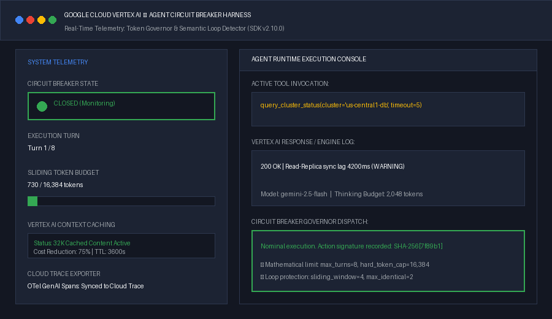
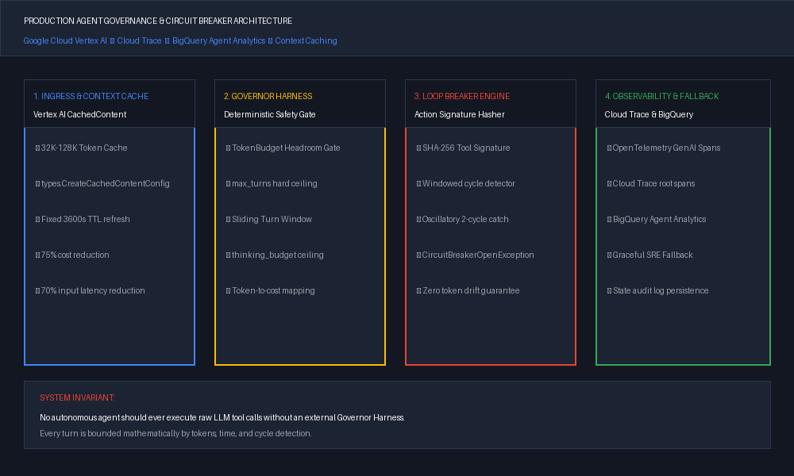
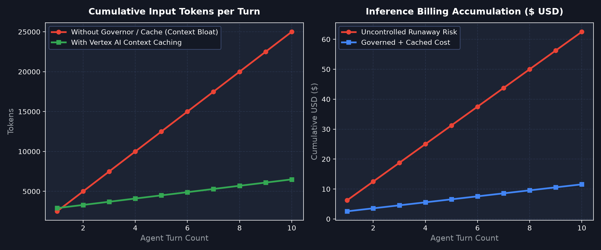

# Vertex AI Agent Governor: Production Circuit Breaker & Token Governor Harness

[](https://www.python.org/downloads/)
[](https://cloud.google.com/vertex-ai)
[](https://opensource.org/licenses/Apache-2.0)
[](https://github.com/aniketagrawal2012/vertex-ai-agent-governor)

A production-grade execution harness for autonomous agents built on **Google Cloud Vertex AI** and the official **Google GenAI SDK (`google.genai` v2.10.0)**. 

Enforces mathematical ceilings on token consumption, arrests runaway tool-calling loops with SHA-256 action-signature hashing, and leverages native **Vertex AI Context Caching** to reduce input token billing by up to **75%**.

---



---

## ⚡ Why Do Production Agents Need a Governor?

When moving from single-turn chatbots to multi-step autonomous agents, unconstrained tool-calling while-loops introduce three severe production failure modes:

1. **Oscillatory Tool Loops**: When tools return transient warnings or non-fatal errors, models often re-invoke the tool with minor parameter mutations, entering an infinite loop.
2. **Quadratic Context Accumulation**: Appending every execution step into conversation context causes token consumption to compound as $\mathcal{O}(T^2)$, driving sudden 10x API billing spikes.
3. **State Corruption on Crash**: When an un-governed agent fails after mutating cloud resources, downstream systems are left in an un-audited, half-applied state.

**Vertex AI Agent Governor** decouples runtime execution boundaries from the model's probabilistic reasoning, ensuring deterministic shutdown, state checkpointing, and graceful fallbacks.

---

## 🏛️ Architecture Overview



The governor harness enforces four operational pillars:

| Pillar | Mechanism | Enterprise Benefit |
| :--- | :--- | :--- |
| **1. Token Governor** | Mathematical headroom check on prompt, candidate, and thinking tokens | Prevents budget overruns and unexpected API spikes |
| **2. Loop Detector** | Canonical SHA-256 tool signature hashing + sliding-window n-gram analysis | Stops single-action repeats and alternating 2-cycle oscillations |
| **3. Context Caching** | Native Vertex AI `CachedContent` with configurable TTLs | 75% input token discount and 70% latency reduction |
| **4. Observability & Fallback** | OpenTelemetry GenAI semantic spans exported to Google Cloud Trace | Full causal audit trails and deterministic state checkpoints |

---

## 🚀 Quickstart

### 1. Installation

```bash
git clone https://github.com/aniketagrawal2012/vertex-ai-agent-governor.git
cd vertex-ai-agent-governor
pip install -r requirements.txt
```

### 2. Run the Production Simulation

```bash
python examples/run_sre_agent_simulation.py
```

### 3. Basic Usage in Your Agent Application

```python
from agent_governor import (
    VertexAIAgentGovernorHarness,
    TokenBudget,
    CircuitBreakerOpenException,
)

# 1. Define hard operational boundaries
budget = TokenBudget(
    max_total_tokens=16_384,
    max_turn_tokens=4_096,
    max_turns=8,
    max_thinking_budget=2_048,
)

# 2. Instantiate the Governor Harness
harness = VertexAIAgentGovernorHarness(
    model_name="gemini-2.5-flash",
    budget=budget,
    max_loop_iterations=2, # Trip if identical tool call occurs > 2 times in sliding window
)

# 3. Execute agent steps within safety gates
try:
    result = harness.execute_governed_step(
        step_id=1,
        tool_name="restart_compute_node",
        tool_args={"node_id": "gke-pool-1-worker-04"},
        tool_callable=my_gke_tool_fn,
    )
    print(f"Step executed safely: {result['result']}")
except CircuitBreakerOpenException as exc:
    # 4. Graceful fallback on trip
    print(f"Execution halted: {exc.message}")
    dispatch_incident_alert_to_sre(exc.state_checkpoint)
```

---

## 📊 Telemetry: Context Caching vs Uncached Token Growth



By freezing enterprise schemas, system prompts, and policies using Vertex AI's native context caching, subsequent agent turns bypass repetitive input token ingestion, transforming quadratic cost compounding into flat, linear billing.

---

## 🧪 Running Tests

```bash
PYTHONPATH=. python tests/test_governor.py
```

---

## 📄 License

This project is licensed under the Apache License 2.0 - see the [LICENSE](LICENSE) file for details.

---

**Author**: [Aniket Agrawal](https://medium.com/@aniketagrawal_14703)  
*For deep-dives into Frontier Systems Architecture, Hardware Physics, and Production LLMOps on Google Cloud, follow on [Medium](https://medium.com/@aniketagrawal_14703).*
